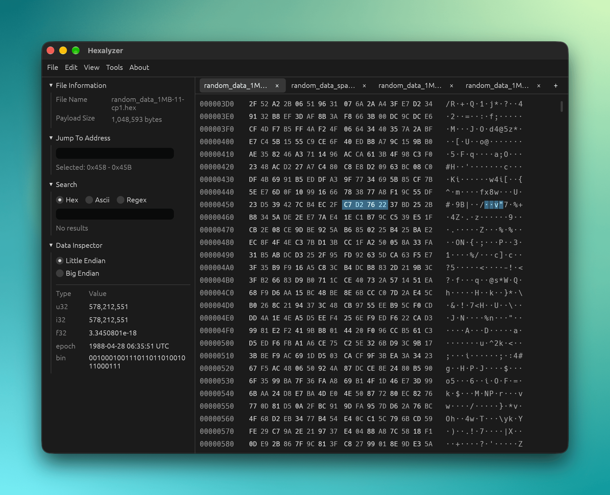

<div align="center">
  
  <h1>Hexalyzer</h1>
</div>

Hexalyzer is an app for inspecting and modifying firmware files and binary data.
It opens Intel HEX files and shows any other file as raw binary, which makes it well suited
to embedded firmware analysis.

The project consists of:
- **Hexalyzer**, a desktop GUI app for viewing and editing HEX and binary files.
- **intelhexlib**, a standalone Rust library for reading, editing and writing Intel HEX
  and binary data.
- **hexcli**, a command-line tool built on the library for inspecting, relocating,
  converting and merging files.




## Installation

Prebuilt installers and the `hexcli` tool are attached to each
[release](https://github.com/iharhl/hexalyzer/releases):

| Platform              | App                                     | CLI                                  |
|-----------------------|-----------------------------------------|--------------------------------------|
| macOS (Apple Silicon) | `Hexalyzer_<version>_aarch64.dmg`       | `hexcli_<version>_macos-arm64.tar.gz`  |
| Windows (x64)         | `Hexalyzer_<version>_x64-setup.exe`     | `hexcli_<version>_windows-x86_64.zip`  |
| Linux (x64)           | `hexalyzer_<version>_amd64.deb` or `hexalyzer_<version>_x86_64.AppImage` | `hexcli_<version>_linux-x86_64.tar.gz` |

Binaries for Intel Macs are not prebuilt so you have to build them from source (see below).

The installers are not code-signed, so the system gives a warning on first launch:
- **macOS**: if macOS says it could not verify that Hexalyzer is free of malware, click "Done",
  then go to System Settings → Privacy & Security and click "Open Anyway".
- **Windows**: if SmartScreen shows "Windows protected your PC", click "More info" → "Run anyway".

Each release also has a `SHA256SUMS.txt` file. To check a download, run
`shasum -a 256 -c SHA256SUMS.txt --ignore-missing` in the folder with both files
(on Windows: `Get-FileHash <file>` and compare by eye).

### Notes for Linux

The file dialogs go through the desktop portal (`xdg-desktop-portal`), which GNOME, KDE
and most other desktops already run. The AppImage may need `libfuse2` on newer distributions.

### Notes for Windows

The installer is per user: it installs into `%LOCALAPPDATA%\Hexalyzer` and does not need
admin rights. Releases up to v0.3.0 installed into `C:\Program Files\Hexalyzer`, so
uninstall that version first (as admin) to avoid having two copies.

### Building from source

Building needs Rust 1.95 or newer. The repository pins the exact compiler
in `rust-toolchain.toml`, which `rustup` installs automatically on the first build.

Use [cargo packager](https://crates.io/crates/cargo-packager) to build an installer for your platform.
Go into hexalyzer directory `cd hexalyzer` and run `cargo packager --release`.
It builds the app first and then packages it: a `.dmg` on macOS, a `-setup.exe`
on Windows, and Linux packages such as `.deb` and AppImage
(pick them with e.g. `--formats deb,appimage`).

To build the CLI tool, run
`cargo build -p intelhexlib --features cli --release`

On Linux, building the GUI requires the X11 / Wayland development headers. On Debian / Ubuntu:

```bash
sudo apt-get install libxkbcommon-dev libwayland-dev \
  libxcb-render0-dev libxcb-shape0-dev libxcb-xfixes0-dev
```

On Windows, the executable icon is embedded at build time by the `winresource` build
dependency, so no extra setup is needed.


## Usage

### Getting started

1. **Open a File**: Use the `File → Open file...` menu or drag and drop a `.hex` or `.bin`
file into the main window.

2. **Navigate**: Use the scroll area to browse the data. The center panel displays the
hex values and their ASCII equivalents side-by-side. Use side panel to jump to a specific
hex address or search for a byte / ASCII value(s).

3. **Edit**: Select a byte (or a range) and type two hex digits to set its value. Changes are
tracked and can be reverted if needed. Closing a tab or quitting the app with unsaved changes
asks for confirmation.

4. **Inspect**: Use the side panel to see how the selected bytes are interpreted as
different data types (integers, floats, etc.). Multibyte selection is possible!

### Keyboard shortcuts

On Windows and Linux, use `Ctrl` instead of `Cmd`.

| Shortcut              | Action                                           |
|-----------------------|--------------------------------------------------|
| `0`–`9`, `A`–`F`      | Type a new value for the selected byte(s)        |
| Arrow keys            | Move the selection                               |
| `Shift` + click       | Extend the selection                             |
| `Esc`                 | Cancel the current edit, selection or search     |
| `Cmd+S`               | Save the current file                            |
| `Cmd+C`               | Copy selected bytes as hex                       |
| `Cmd+Shift+C`         | Copy selected bytes as ASCII                     |
| `Alt+C`               | Copy the address of the selection                |

### Menu options

The top menubar provides access to the core file management and data transformation
tools:

#### File

- `Open file...`: Browse your system to load a file into a new tab.
- `Save` (`Cmd+S` / `Ctrl+S`): Overwrite the current file with your changes (in its original format).
- `Export...`: Save a copy of your current session to a new file (format chosen by extension) and open it in a new tab.
- `Gap Fill: 0xFF`: Submenu to set the byte used to fill address gaps when exporting to BIN.
- `Reload`: Reload the current file from disk.
- `Close file`: Close the current tab.

#### Edit

- `Relocate...`: Relocate the current file to a new start address.
- `Merge...`: Merge selected file into the current one. Before merging, new start
addresses can be specified for both files.
- `Insert Range...`: Insert range of bytes at provided address range.
- `Remove Range...`: Remove range of bytes from provided address range.
- `Restore byte changes`: Discard all changes made to the current file.
- `Copy as Hex` / `Copy as ASCII` / `Copy Address`: Copy selected bytes to clipboard as hex, ASCII or their (start) address.

#### View

- `Show Sidebar`: Toggle the side panel (can also be done by dragging or double-clicking the edge).
- `Select Bytes per Row`: Switch between displaying 16 or 32 bytes per row.

#### Tools

- `Hex Converter`: a helper tool that can convert between HEX / DEC / BIN / ASCII formats;
accounts for the endianness and signedness of the data.

#### About

Displays version information and credits for the Hexalyzer project.


## Intel HEX Library

The core of Hexalyzer is powered by a standalone Intel HEX parsing library `intelhexlib`. It is designed to
handle memory-sparse firmware files using a BTreeMap buffer.

### Key Features

- **Sparse Data Support**: Uses `BTreeMap<usize, Vec<u8>>` to store data, meaning files with large gaps
between memory segments don't consume unnecessary RAM. Performance remains optimized by storing
contiguous chunks. The key represents the starting address, and the `Vec<u8>` contains the
payload which ensures fast lookups.

- **Data editing**: Allows updating single bytes, byte ranges, supports relocation to a new
start address, merging, etc.

- **Flexible API**: Allows for easy parsing and update of hex data as well as straightforward
integration into other projects.

### Adding to a project

The library is not published on crates.io. Add it as a git dependency, pinned to a release tag:

```toml
[dependencies]
intelhexlib = { git = "https://github.com/iharhl/hexalyzer", tag = "v0.4.0" }
```

### Usage Example

```rust
use intelhexlib::IntelHex;
use std::path::PathBuf;

fn main() {
    // Load and parse a file
    let path = PathBuf::from("firmware.hex");
    if let Ok(mut ih) = IntelHex::from_hex(&path) {
        println!("Loaded {} bytes from {:?}", ih.size, ih.filepath);

        // Access data at a specific address
        let address: usize = 0x0800_0000;
        if let Some(byte) = ih.read_byte(address) {
            println!("Byte at {:X}: {:02X}", address, byte);
        }

        // Update data at a specific address
        let new_value = 0x0F;
        match ih.update_byte(address, new_value) {
            Ok(()) => println!("Updated byte at {:X} to: {:02X}", address, new_value),
            Err(err) => println!("Error during update: {err}"),
        }

        // Iterate over all bytes, ignoring address gaps.
        // Since it uses a BTreeMap, keys are always sorted by address.
        // To iterate over contiguous chunks, use ih.iter() instead.
        for (addr, byte) in ih.bytes().take(10) {
            println!("{:X}: {:02X}", addr, byte);
        }
    }
}
```

### CLI

A CLI tool `hexcli` is also available for parsing and editing Intel HEX files.

Its functionality includes:
- Getting info about a file.
- Relocating the file to a new start address.
- Converting a file between BIN and HEX formats.
- Merging multiple files into a single one (mixing BIN and HEX files is allowed).

```text
 ----------------------------------------------------------------
|  Intel HEX Utility  | v0.4.0 - Copyright (c) 2026 Ihar Hlukhau |
 ----------------------------------------------------------------

Usage:
  hexcli info <input>
  hexcli relocate <input> <output> [options]
  hexcli convert <input> <output> [options]
  hexcli merge <output> <input1>[:addr] ... <inputN>[:addr] [options]

Options:
  --address <val>    Base address for relocate / convert from BIN to HEX
  --gap-fill <val>   Byte to fill gaps when converting / merging to BIN (default: 0xFF)
  --overwrite        Merge: later inputs replace overlapping data (default: error)

Examples:
  hexcli info firmware.hex
  hexcli relocate firmware.hex firmware_shifted.hex --address 0x1000
  hexcli convert firmware.hex firmware.bin --gap-fill 0x00
  hexcli merge final.hex firmware1.hex firmware2.bin:0xFF00
```


## Development

The repository is a Cargo workspace with two crates: `hexalyzer` (GUI app) and
`intelhexlib` (library and `hexcli` tool).

Common tasks are run through `run.sh`:
- `./run.sh check`: format the code and run clippy with strict lints.
- `./run.sh test`: run CLI, doc, unit and integration tests, with a coverage report
  (requires [cargo-llvm-cov](https://crates.io/crates/cargo-llvm-cov)).
- `./run.sh bench`: run the `intelhexlib` benchmarks.

Every pull request is checked by GitHub Actions: formatting, clippy (warnings fail the build)
and the full test suite on Linux, macOS and Windows.

To make a release, bump the version in the root `Cargo.toml`, run `cargo check` so `Cargo.lock`
picks up the new version (CI builds with `--locked`), and push a matching tag.
The release workflow runs the checks, builds the installers and CLI for macOS, Windows and Linux,
and attaches them with a checksum file to a draft GitHub release, ready for release
notes and publishing. To test the release build without making a release, run the Release
workflow manually from the Actions tab; the files are attached to that run. To update Rust, bump `channel` in `rust-toolchain.toml`.


## History

v0.1.0 (2026-01-14) - Initial Release.

v0.2.0 (2026-01-30) - Release with added usability features and
improved performance.

v0.3.0 (2026-06-20) - Added lots of new features; improved UX.

v0.4.0 (2026-11-18) - Stability and robustness release: atomic file saves, stricter parsing,
and many edge-case fixes. Hex converter has its own window, Linux package is added, as well as
per-user Windows install.


## Future app improvement ideas

1. Support Undo / Redo.
2. Support ELF format.
3. Saving an entire app state.
4. Introduce ViewModel layer. Right now, UI tightly couples rendering and model details.
This will enable adding Comparison (Diff) tool which can reuse the same model.